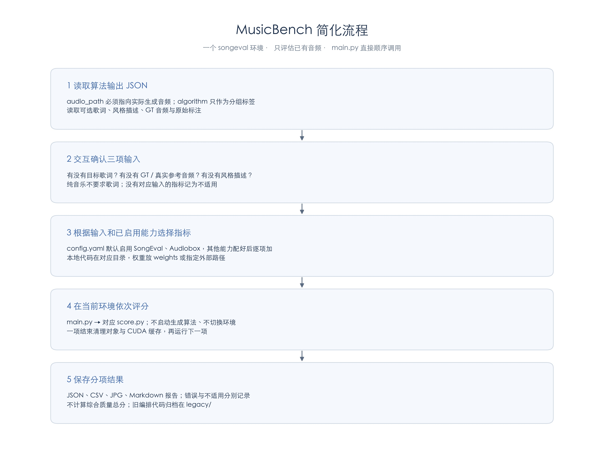
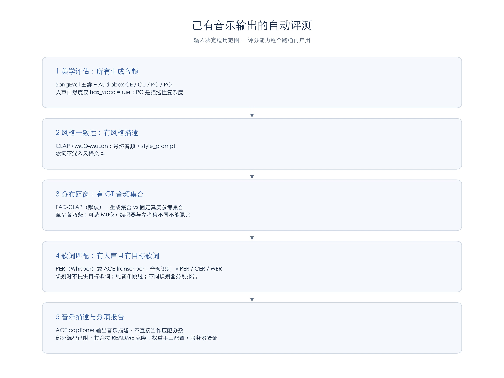

# MusicBench

交互式、多算法、独立环境的音乐评测框架。当前重点是文生音乐：按任务固定指标规则，根据可用输入自动启用评测，所有算法和评分器串行运行。

```bash
conda env create -f envs/benchmark.yml
conda activate musicbench
pip install -e .
# 首次运行：准备评分器依赖和模型权重（较大的下载）
python scripts/setup_metrics.py
./run.sh
```

已激活评测主环境时可用 `BENCH_ENV=current ./run.sh`。完整配置示例见 [experiment.example.yaml](configs/experiment.example.yaml)，使用、数据格式、环境准备和扩展方法见 [工作流文档](docs/WORKFLOW.md)。

## 文生音乐主指标

| 分类 | 指标 | 启用条件 |
| --- | --- | --- |
| 美学（含结构） | Audiobox CE/CU/PC/PQ；SongEval 五项 | 所有生成结果；人声自然度仅统计明确有人声的样本 |
| 歌词匹配 | PER + 中文 CER / 英文 WER，错漏明细 | 有目标歌词 |
| 风格匹配 | CLAP + MuQ-MuLan | 有 style_prompt |
| 真实音乐分布距离 | FAD（CLAP audio features） | 有真实音乐参考集合 |

结果按分类展示，不计算综合质量总分。PC 是复杂程度描述，不默认越高越好。自动分数不等于人工听评，也不声称替代 ACE 论文的专有奖励分数。

## 流程





两张 JPG 均保存在项目根目录。更新流程后可运行 `python scripts/render_workflow_diagrams.py` 重新导出；Linux 可通过 `--font /path/to/NotoSansCJK-Regular.ttc` 指定中文字体。


任务 → 确认输入 → 选择算法和环境/显卡 → 设置算法及测试参数 → 保存 YAML → 随机抽样 → 算法 A 推理与评测 → 算法 B 推理与评测 → 分类图片和分析报告。

```bash
./run.sh text2music
./run.sh --dry-run --save-config configs/my-experiment.yaml
./run.sh --config configs/my-experiment.yaml --output runs/experiment-01
```

每次实验保存配置、实际测试清单、参考集合路径、生成音乐、原始分数、识别歌词和错漏明细、评分器版本、子进程日志与完成状态。缺少输入记为不适用；应该执行却缺模型/依赖记为失败。默认保留失败报告并以非零状态退出。

## 一键配置评测库和权重

`python scripts/setup_metrics.py` 按指标分别创建 conda 环境、下载模型权重并检查模型能否加载。CLAP 与 FAD 共用环境和权重，歌词识别默认先做 Demucs 人声分离。所有安装/检查串行执行。

已有 SongEval 时，在主环境中执行（替换为你的实际环境名和路径）：

```bash
python scripts/setup_metrics.py --dry-run
python scripts/setup_metrics.py \
  --reuse songeval=your_songeval_env \
  --songeval-repo /data/SongEval \
  --cache-dir /data/musicbench-models
python scripts/setup_metrics.py --check-only
./run.sh text2music
```

成功后生成 `configs/metrics.local.yaml`，实验自动读取其中的环境、权重及缓存配置，交互时可继续修改。实验 YAML 的显式配置优先。只装部分指标可使用 `--metrics audiobox songeval clap_score fad`；未安装的指标若被任务启用仍会报失败，应在正式测试前补齐。只安装库使用 `--libraries-only`，离线检查现有库与权重使用 `--check-only`。

已有环境只检查，不会被覆盖或自动升级；某项失败会保留日志和原配置。安装检查使用 CPU，服务器 GPU/CUDA 兼容性还需用少量样本确认。完整下载清单、复用环境、离线部署和排错见 [评测库配置流程](docs/METRIC_SETUP.md)。

## MusicLite 测试数据

文生音乐默认从 `/data/MusicLite_data/feature` 下各日期的 `5_with_latent.json` 抽样，兼容 JSON 放在日期目录或 audio 子目录。默认按日期随机轮转、每个日期内随机不放回选择，也可选 `pooled` 全库记录等概率抽样。

音频只打包一次，所有算法共用相同测试清单；来源日期、JSON 校验值和抽样统计写入 `dataset/sampling.json`。原始特征、标注和未来新增字段完整保留；新增 lyrics/language 后可以启用歌词指标。详细规则和 YAML 示例见 [输入数据说明](docs/WORKFLOW.md#输入数据)。

## 环境与算法

主环境负责配置、数据和报告，各算法/评分器使用 `conda run` 指定环境，不需要手动反复 activate。无需把所有模型依赖装在一起。现有 SongEval 仓库与环境可直接通过 YAML 指定，详见 [SongEval 接入](docs/SONGEVAL.md)。

算法在 `algorithms/<name>/config.yaml` 声明 task、env、infer_script 和 parameter_schema。推理脚本只需接收 `--manifest`、`--output`，通过 JSON/JSONL 交换数据，不要求安装 MusicBench。`my_t2m` 是正弦音模板，`t2m_passthrough` 复制参考音频，两者仅用于流程调试，接真实模型后再做算法比较。

任务和指标通过注册表及 YAML 扩展。另保留节拍跟踪、音乐标签任务和原有单模型 `musicbench run/evaluate/report` 命令；旧命令不承担新的多环境编排，历史指标配置保留兼容。

## 新增音乐生成算法

支持登记已有适配脚本，也支持生成适配模板。登记完成后，`./run.sh` 会在对应任务下自动显示新算法，不需要修改评测主流程。命令在已安装本项目的主环境中执行；算法依赖和模型权重在算法自己的环境中准备。

### 方式一：交互式登记

```bash
python -m musicbench.algorithms add
```

依次填写算法名称、任务、已有 conda 环境、显卡编号；已有适配脚本则填写脚本与工作目录，没有则留空创建模板。也可用安装后的 `musicbench-algorithms add`。

### 方式二：创建新算法模板

```bash
python -m musicbench.algorithms add \
  --name new_generator --task text2music --env new_generator_env --gpu 0
```

生成 `algorithms/new_generator/config.yaml`、`infer.py` 和接入说明。在 infer.py 的 **load_model()** 和 **generate()** 两个函数中接入真实模型。模板在完成接入前会明确报错，不会生成假结果。默认模板面向文生音乐；其他任务需提供自己的适配脚本。

`generate(model, sample, args)` 返回 `(音频数组, 采样率)`，音频数组约定为单声道 `[时间]` 或多声道 `[时间, 声道]`。模型返回 `[声道, 时间]`、GPU Tensor 等格式时，请在适配函数里转为 CPU NumPy 并调整维度。模板通过 soundfile 保存 WAV，算法环境需要安装 `soundfile`。

### 方式三：登记已有算法项目中的适配脚本

```bash
python -m musicbench.algorithms add \
  --name ace_step --task text2music --env ace_step_env --gpu 0 \
  --script /data/musicbench_adapters/ace_infer.py \
  --cwd /data/ACE-Step-1.5 \
  --schema /data/musicbench_adapters/ace_parameters.yaml
```

脚本可以保留在外部算法目录，无需复制权重或整个仓库。cwd 是运行工作目录，infer_script 是适配脚本路径；运行时会使用登记的工作目录并让它能被 Python 导入。**原算法脚本必须满足下面的输入输出契约，否则需要先编写一层适配。** 此示例只是登记方式，不代表已经提供 ACE 模型的专用实现。

### 声明测试时要询问的算法参数

`--schema` 读取一个 YAML 参数定义映射。也可直接编辑 `algorithms/<name>/config.yaml` 中的 parameter_schema，例如：

```yaml
name: ace_step
task: text2music
env: ace_step_env
cuda_visible_devices: '0'
cwd: /data/ACE-Step-1.5
infer_script: /data/musicbench_adapters/ace_infer.py
parameter_schema:
  checkpoint:
    flag: --checkpoint
    type: path
    label: 模型权重路径
    required: true
  steps: {flag: --steps, type: int, minimum: 1, default: 30, label: 采样步数}
  guidance: {flag: --guidance, type: float, default: 3.0, label: 引导强度}
  duration: {flag: --duration, type: float, minimum: 0.1, default: 30, label: 生成时长（秒）}
parameters: {}
args: []
```

交互会按定义逐项提问，将值写进实验 YAML，并转换为对应命令行参数。flag 必须与适配脚本实际支持的参数一致；类型支持 str/int/float/path/bool，bool 为真时只传 flag。`--manifest` 和 `--output` 由框架提供，不能在参数定义中覆盖。相对 cwd 以算法 config.yaml 所在目录解析，infer_script 以 cwd 解析；权重建议填绝对路径。

若没有 parameter_schema，主交互会询问额外命令行参数，并保存为 args 列表。不同算法可以定义不同参数，不必强行统一参数名。

### 推理适配脚本的输入输出契约

程序在该算法环境中执行：

```bash
python /path/to/adapter.py --manifest /abs/manifest.json --output /abs/predictions.jsonl
```

输入 manifest 是 JSON 数组，样本如下。style_prompt 和 lyrics 分开传给生成模型；audio_path 可以为空。

```json
[{"id":"sample-1","audio_path":"","metadata":{"style_prompt":"acoustic pop, female vocals","lyrics":"你好世界","language":"zh","has_vocal":true,"generation_seed":42}}]
```

输出 predictions.jsonl 每行对应一个输入 ID，全部样本必须有唯一且匹配的输出：

```json
{"id":"sample-1","output":{"audio_path":"/abs/generated/sample-1.wav"}}
```

生成音乐必须确实存在；推荐绝对音频路径，相对路径以 predictions.jsonl 所在目录解析。不要在推理脚本中自行抽取另一批测试数据。每条输入的 generation_seed 供算法设置随机种子，重复生成时框架会创建不同 ID 与种子。

### 查看、检查并开始评测

```bash
python -m musicbench.algorithms list --task text2music
./run.sh text2music --dry-run --save-config configs/new-experiment.yaml
./run.sh --config configs/new-experiment.yaml
```

先通过 `--dry-run` 保存和检查参数，再正式运行。dry-run 不加载模型，也不验证生成质量。登记命令不会覆盖同名算法，修改已有算法时显式编辑其配置即可。新算法通过 JSON 契约接入，不要求在其环境安装 MusicBench。

## 验证

```bash
pytest -q
```

测试使用短音频、数学样例和外部评分器接口替身，不下载大模型。真实评分需要配置相应环境与权重。
